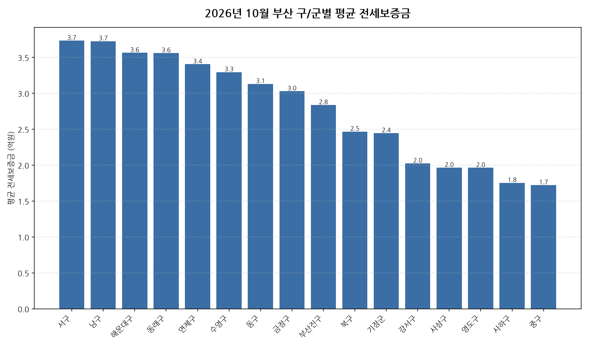

공공데이터포털의 국토교통부 아파트 전월세 실거래자료를 파이썬으로 직접 수집·분석해
2026년 10월 부산 아파트 순수 전세 시장 흐름을 정리했습니다.

## 분석 방법

- 데이터 출처: [국토교통부 아파트 전월세 실거래자료](https://www.data.go.kr/data/15126474/openapi.do) (공공데이터포털 Open API)
- 분석 대상: 부산 16개 구/군, 2026년 10월 신고 기준 순수 전세 계약
- 비교 기준월: 2026년 9월 (전월 대비 증감률 계산용)
- 실거래 신고는 계약 후 30일 이내에 이루어지므로, 최근월 데이터는 이후 계속 소폭 갱신될 수 있습니다.
- 데이터 수집 기준일: 2026-11-23. 이후 늦게 신고된 계약이 반영되면 같은 달을 다룬 다른 글과 수치가 조금 다를 수 있습니다.

## 부산 구/군별 평균 전세보증금과 전월 대비 변화

| 구/군 | 평균 전세보증금(억원) | 중위 전세보증금(억원) | 전월 대비 | 거래건수 |
|---|---:|---:|---:|---:|
| 서구 | 3.7 | 3.5 | +5.9% | 50 |
| 남구 | 3.7 | 3.4 | -6.5% | 152 |
| 해운대구 | 3.6 | 3.2 | -6.0% | 319 |
| 동래구 | 3.6 | 3.5 | +6.8% | 198 |
| 연제구 | 3.4 | 3.4 | +7.1% | 152 |
| 수영구 | 3.3 | 3.4 | +6.1% | 112 |
| 동구 | 3.1 | 3.3 | +14.1% | 43 |
| 금정구 | 3.0 | 2.9 | +9.2% | 85 |
| 부산진구 | 2.8 | 2.8 | +11.5% | 263 |
| 북구 | 2.5 | 2.6 | -3.1% | 114 |
| 기장군 | 2.4 | 2.4 | +2.3% | 82 |
| 강서구 | 2.0 | 1.5 | +5.9% | 255 |
| 사상구 | 2.0 | 1.8 | +26.7% | 66 |
| 영도구 | 2.0 | 1.9 | +5.1% | 42 |
| 사하구 | 1.8 | 1.6 | -17.7% | 94 |
| 중구 | 1.7 | 1.8 | - | 4 |

## 부산 10월 전세가 동향 인사이트

- 2026년 10월 부산 아파트 순수 전세 평균 전세보증금은 약 3.0억원으로, 전월 대비 3.4% 상승했습니다.
- 16개 구/군 중 평균 전세보증금이 가장 높은 곳은 서구(약 3.7억원)이었고, 가장 낮은 곳은 중구(약 1.7억원)이었습니다.
- 거래량 기준으로는 해운대구에서 319건으로 가장 활발하게 순수 전세 계약이 체결됐습니다.
- 전월 대비 평균이 가장 많이 오른 곳은 사상구(+26.7%), 가장 많이 내린 곳은 사하구(-17.7%)였습니다 (두 달 모두 10건 이상 거래된 곳만 비교).
- 2026년 10월 부산에서 신고된 순수 전세 계약은 총 2031건입니다 (월세를 낀 반전세/월세 계약은 제외).
