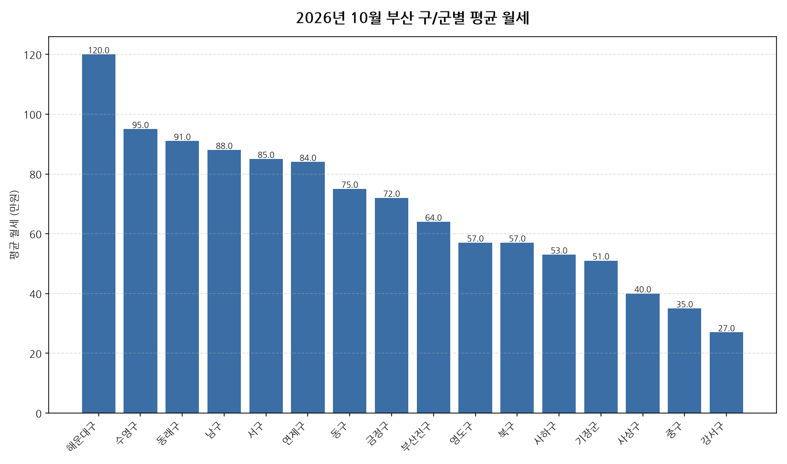

공공데이터포털의 국토교통부 아파트 전월세 실거래자료를 파이썬으로 직접 수집·분석해
2026년 10월 부산 아파트 월세(반전세 포함) 시장 흐름을 정리했습니다.

## 분석 방법

- 데이터 출처: [국토교통부 아파트 전월세 실거래자료](https://www.data.go.kr/data/15126474/openapi.do) (공공데이터포털 Open API)
- 분석 대상: 부산 16개 구/군, 2026년 10월 신고 기준 월세(반전세 포함) 계약
- 비교 기준월: 2026년 9월 (전월 대비 증감률 계산용)
- 실거래 신고는 계약 후 30일 이내에 이루어지므로, 최근월 데이터는 이후 계속 소폭 갱신될 수 있습니다.
- 데이터 수집 기준일: 2026-11-25. 이후 늦게 신고된 계약이 반영되면 같은 달을 다룬 다른 글과 수치가 조금 다를 수 있습니다.

## 부산 구/군별 평균 월세와 전월 대비 변화

| 구/군 | 평균 월세(만원) | 중위 월세(만원) | 전월 대비 | 거래건수 |
|---|---:|---:|---:|---:|
| 해운대구 | 120.0 | 92.0 | -7.0% | 296 |
| 수영구 | 95.0 | 75.0 | +10.5% | 115 |
| 동래구 | 91.0 | 72.0 | +13.8% | 138 |
| 남구 | 88.0 | 72.0 | -16.2% | 111 |
| 서구 | 85.0 | 62.0 | +84.8% | 48 |
| 연제구 | 84.0 | 70.0 | -1.2% | 105 |
| 동구 | 75.0 | 59.0 | -35.3% | 30 |
| 금정구 | 72.0 | 65.0 | +4.3% | 81 |
| 부산진구 | 64.0 | 48.0 | -1.5% | 304 |
| 영도구 | 57.0 | 48.0 | +14.0% | 66 |
| 북구 | 57.0 | 50.0 | +5.6% | 155 |
| 사하구 | 53.0 | 50.0 | -3.6% | 120 |
| 기장군 | 51.0 | 30.0 | -17.7% | 216 |
| 사상구 | 40.0 | 40.0 | +5.3% | 143 |
| 중구 | 35.0 | 35.0 | - | 9 |
| 강서구 | 27.0 | 9.0 | -57.8% | 352 |

## 부산 10월 월세 시장 인사이트

- 2026년 10월 부산 아파트 월세(반전세 포함) 평균 월세는 약 67.6만원으로, 전월 대비 12.0% 하락했습니다.
- 16개 구/군 중 평균 월세가 가장 높은 곳은 해운대구(약 120.0만원)이었고, 가장 낮은 곳은 강서구(약 27.0만원)이었습니다.
- 거래량 기준으로는 강서구에서 352건으로 가장 활발하게 월세(반전세 포함) 계약이 체결됐습니다.
- 전월 대비 평균이 가장 많이 오른 곳은 서구(+84.8%), 가장 많이 내린 곳은 강서구(-57.8%)였습니다 (두 달 모두 10건 이상 거래된 곳만 비교).
- 2026년 10월 부산에서 신고된 월세(반전세 포함) 계약은 총 2289건입니다 (순수 전세 계약은 제외).

---

이런 데이터를 직접 파이썬으로 분석해보고 싶으신 분들을 위해, 공공데이터포털 아파트 매매/전월세 데이터를 분석하는 방법을 담은 전자책 《파이썬을 활용한 부동산 시장 분석_아파트편》을 준비했어요. 2026년 데이터를 기준으로 다루고 있고, 교보문고에서 만나보실 수 있어요: https://ebook-product.kyobobook.co.kr/dig/epd/ebook/480D250151380
