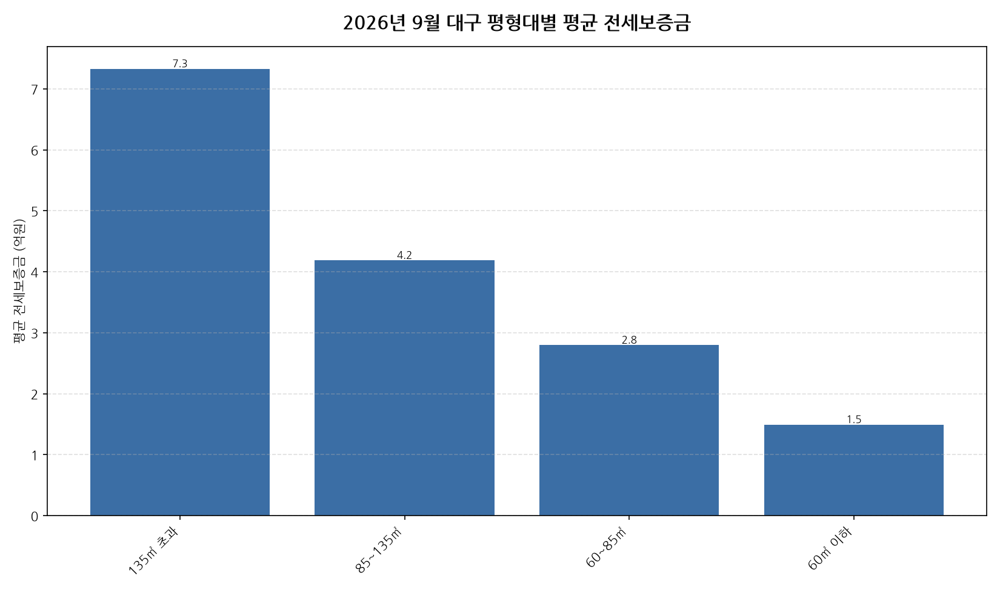

공공데이터포털의 국토교통부 아파트 전월세 실거래자료를 파이썬으로 직접 수집·분석해
2026년 9월 대구 아파트 순수 전세 시장 흐름을 정리했습니다.

## 분석 방법

- 데이터 출처: [국토교통부 아파트 전월세 실거래자료](https://www.data.go.kr/data/15126474/openapi.do) (공공데이터포털 Open API)
- 분석 대상: 대구 4개 평형대 구간, 2026년 9월 신고 기준 순수 전세 계약
- 비교 기준월: 2026년 8월 (전월 대비 증감률 계산용)
- 실거래 신고는 계약 후 30일 이내에 이루어지므로, 최근월 데이터는 이후 계속 소폭 갱신될 수 있습니다.
- 데이터 수집 기준일: 2026-10-16. 앞서 발행한 [2026년 9월 대구 아파트 전세가 동향]()(2026-10-12 수집, 총 1,049건·전월 대비 3.4% 상승) 이후 늦게 신고된 계약이 반영되어, 이 글의 전체 수치(총 1,090건·3.8% 상승)와 조금 다릅니다.

## 2026년 9월 대구 아파트 평형대별 전세가 분석 · 평형대별 평균 전세보증금

| 평형대 | 평균 전세보증금 | 중위 전세보증금 | 거래건수 |
|---|---:|---:|---:|
| 135㎡ 초과 | 7.3 | 7.3 | 15 |
| 85~135㎡ | 4.2 | 3.9 | 101 |
| 60~85㎡ | 2.8 | 2.6 | 715 |
| 60㎡ 이하 | 1.5 | 1.4 | 259 |

## 2026년 9월 대구 아파트 평형대별 전세가 분석 · 평형대별 인사이트

- 2026년 9월 대구 아파트 순수 전세 평균 전세보증금은 약 2.7억원으로, 전월 대비 3.8% 상승했습니다.
- 4개 평형대 구간 중 평균 전세보증금이 가장 높은 구간은 135㎡ 초과(약 7.3억원)이었고, 가장 낮은 구간은 60㎡ 이하(약 1.5억원)이었습니다.
- 거래량 기준으로는 60~85㎡에서 715건으로 가장 활발하게 순수 전세 계약이 체결됐습니다.
- 2026년 9월 대구에서 신고된 순수 전세 계약은 총 1090건입니다 (월세를 낀 반전세/월세 계약은 제외).

---

이런 데이터를 직접 파이썬으로 분석해보고 싶으신 분들을 위해, 공공데이터포털 아파트 매매/전월세 데이터를 분석하는 방법을 담은 전자책 《파이썬을 활용한 부동산 시장 분석_아파트편》을 준비했어요. 2026년 데이터를 기준으로 다루고 있고, 교보문고에서 만나보실 수 있어요: https://ebook-product.kyobobook.co.kr/dig/epd/ebook/480D250151380
