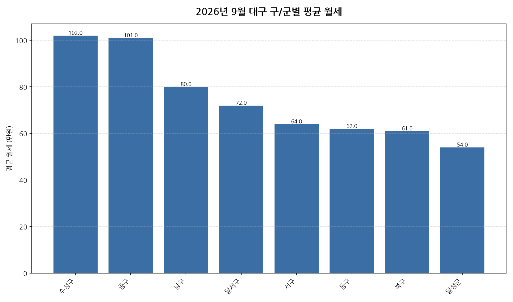

공공데이터포털의 국토교통부 아파트 전월세 실거래자료를 파이썬으로 직접 수집·분석해
2026년 9월 대구 아파트 월세(반전세 포함) 시장 흐름을 정리했습니다.

## 분석 방법

- 데이터 출처: [국토교통부 아파트 전월세 실거래자료](https://www.data.go.kr/data/15126474/openapi.do) (공공데이터포털 Open API)
- 분석 대상: 대구 9개 구/군, 2026년 9월 신고 기준 월세(반전세 포함) 계약
- 비교 기준월: 2026년 8월 (전월 대비 증감률 계산용)
- 실거래 신고는 계약 후 30일 이내에 이루어지므로, 최근월 데이터는 이후 계속 소폭 갱신될 수 있습니다.

## 2026년 9월 대구 아파트 월세 시장 동향 · 구/군별 평균 월세

| 구/군 | 평균 월세 | 중위 월세 | 거래건수 |
|---|---:|---:|---:|
| 수성구 | 102.0 | 95.0 | 193 |
| 중구 | 101.0 | 112.0 | 76 |
| 남구 | 80.0 | 82.0 | 40 |
| 달서구 | 72.0 | 58.0 | 193 |
| 서구 | 64.0 | 52.0 | 52 |
| 동구 | 62.0 | 50.0 | 205 |
| 북구 | 61.0 | 55.0 | 164 |
| 달성군 | 54.0 | 50.0 | 148 |

## 2026년 9월 대구 아파트 월세 시장 동향 · 구/군별 인사이트

- 2026년 9월 대구 아파트 월세(반전세 포함) 평균 월세는 약 73.5만원으로, 전월 대비 1.9% 하락했습니다.
- 9개 구/군 중 평균 월세가 가장 높은 곳은 수성구(약 102.0만원)이었고, 가장 낮은 곳은 달성군(약 54.0만원)이었습니다.
- 거래량 기준으로는 동구에서 205건으로 가장 활발하게 월세(반전세 포함) 계약이 체결됐습니다.
- 2026년 9월 대구에서 신고된 월세(반전세 포함) 계약은 총 1071건입니다 (순수 전세 계약은 제외).
