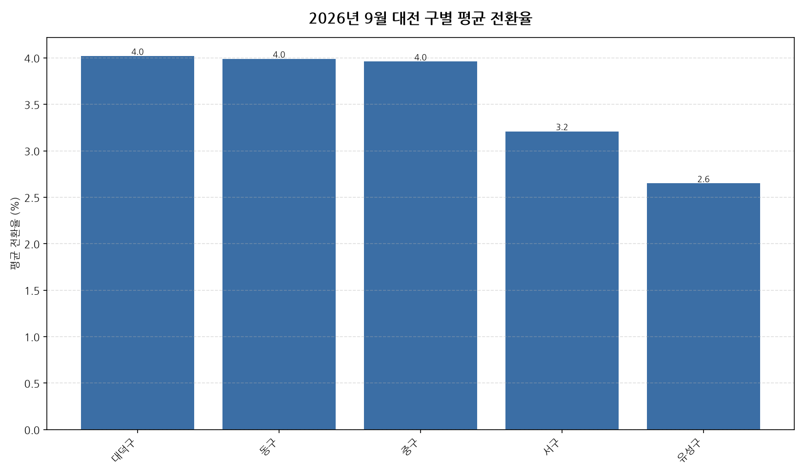

공공데이터포털의 국토교통부 아파트 전월세 실거래자료를 파이썬으로 직접 수집·분석해
2026년 9월 대전 아파트 반전세(전월세 전환) 시장 흐름을 정리했습니다.

## 분석 방법

- 데이터 출처: [국토교통부 아파트 전월세 실거래자료](https://www.data.go.kr/data/15126474/openapi.do) (공공데이터포털 Open API)
- 분석 대상: 대전 5개 구, 2026년 9월 신고 기준 반전세(전월세 전환) 계약
- 비교 기준월: 2026년 8월 (전월 대비 증감률 계산용)
- 실거래 신고는 계약 후 30일 이내에 이루어지므로, 최근월 데이터는 이후 계속 소폭 갱신될 수 있습니다.
- 데이터 수집 기준일: 2026-10-19. 이후 늦게 신고된 계약이 반영되면 같은 달을 다룬 다른 글과 수치가 조금 다를 수 있습니다.
- 전월세 전환율은 실제 시세 대신 같은 자치구·같은 달의 순수 전세 평균 보증금을 기준가로 삼아 추정한 값입니다(연 환산 %).

## 대전 구별 평균 전환율과 전월 대비 변화

| 구 | 평균 전환율(%) | 중위 전환율(%) | 전월 대비 | 거래건수 |
|---|---:|---:|---:|---:|
| 대덕구 | 4.0 | 3.2 | -2.05%p | 66 |
| 동구 | 4.0 | 2.5 | +0.06%p | 71 |
| 중구 | 4.0 | 3.0 | +0.84%p | 74 |
| 서구 | 3.2 | 2.5 | +0.13%p | 253 |
| 유성구 | 2.6 | 1.7 | -0.30%p | 339 |

## 대전 9월 전월세 전환율 인사이트

- 2026년 9월 대전 아파트 반전세(전월세 전환) 평균 전환율은 약 3.2%로, 전월 대비 3.6% 하락했습니다.
- 5개 구 중 평균 전환율이 가장 높은 곳은 대덕구(약 4.0%)였고, 가장 낮은 곳은 유성구(약 2.6%)였습니다.
- 거래량 기준으로는 유성구에서 339건으로 가장 활발하게 반전세(전월세 전환) 계약이 체결됐습니다.
- 전월 대비 평균이 가장 많이 오른 곳은 중구(+0.84%p), 가장 많이 내린 곳은 대덕구(-2.05%p)였습니다 (두 달 모두 10건 이상 거래된 곳만 비교).
- 2026년 9월 대전에서 신고된 반전세(전월세 전환) 계약은 총 803건입니다 (같은 자치구·같은 달 순수 전세 평균가 대비 환산한 추정치이며, 전환율이 0% 이하이거나 30%를 넘는 이상치는 제외).
