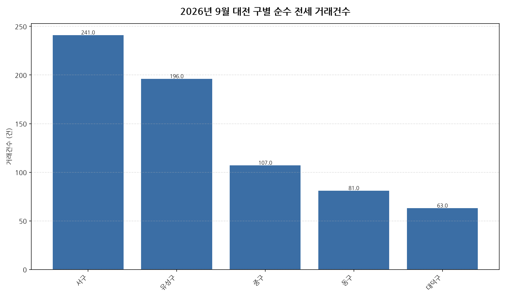

공공데이터포털의 국토교통부 아파트 전월세 실거래자료를 파이썬으로 직접 수집·분석해
2026년 9월 대전 아파트 순수 전세 거래량과 가격 변동률 사이의 관계를 살펴봤습니다.

## 분석 방법

- 데이터 출처: [국토교통부 아파트 전월세 실거래자료](https://www.data.go.kr/data/15126474/openapi.do) (공공데이터포털 Open API)
- 분석 대상: 대전 5개 구, 2026년 9월 신고 기준 순수 전세 계약
- 비교 기준월: 2026년 8월 (전월 대비 가격 변동률 계산용)
- 가격 변동률은 구별 평균 전세보증금 기준이며, 거래건수는 순수 전세 계약 건수 기준입니다.
- 데이터 수집 기준일: 2026-10-21. 이후 늦게 신고된 계약이 반영되면 같은 달을 다룬 다른 글과 수치가 조금 다를 수 있습니다.

## 대전 구별 거래건수와 가격 변동률

| 구 | 거래건수 | 가격변동률(전월 대비) |
|---|---:|---:|
| 서구 | 241 | +5.4% |
| 유성구 | 196 | -2.5% |
| 중구 | 107 | -3.2% |
| 동구 | 81 | +0.0% |
| 대덕구 | 63 | +2.8% |

## 대전 9월 전세 거래량-가격 인사이트

- 2026년 9월 대전 5개 구 중 순수 전세 거래가 가장 활발한 곳은 서구(241건)이었습니다.
- 전월 대비 평균 전세보증금이 가장 많이 오른 곳은 서구(+5.4%), 가장 많이 내린 곳은 중구(-3.2%)이었습니다.
- 거래건수와 가격 변동률의 상관계수는 0.27로, 약한 비례(거래가 많을수록 가격도 더 올랐음) 관계를 보였습니다.
- 상관관계는 인과관계를 의미하지 않으며, 표본 수가 적은 구은 결과가 왜곡될 수 있습니다.
