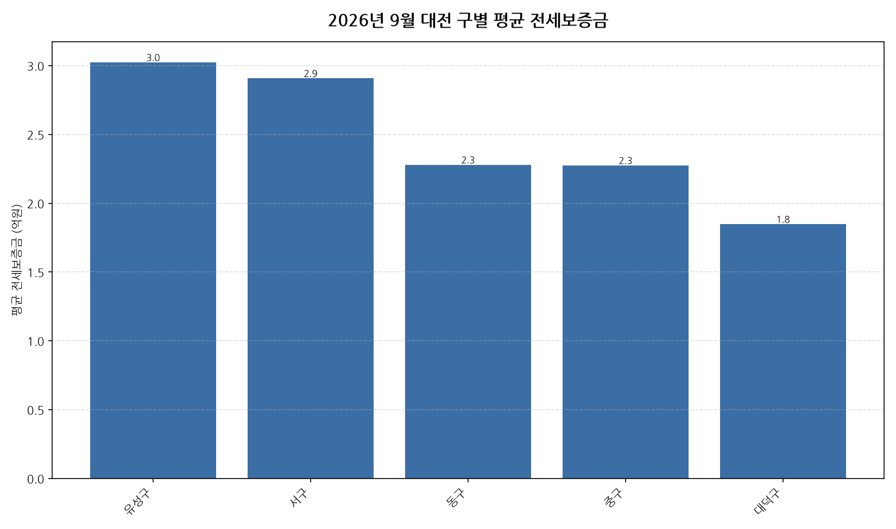

공공데이터포털의 국토교통부 아파트 전월세 실거래자료를 파이썬으로 직접 수집·분석해
2026년 9월 대전 아파트 순수 전세 시장 흐름을 정리했습니다.

## 분석 방법

- 데이터 출처: [국토교통부 아파트 전월세 실거래자료](https://www.data.go.kr/data/15126474/openapi.do) (공공데이터포털 Open API)
- 분석 대상: 대전 5개 구, 2026년 9월 신고 기준 순수 전세 계약
- 비교 기준월: 2025년 9월 (전년 동월 대비 증감률 계산용)
- 실거래 신고는 계약 후 30일 이내에 이루어지므로, 최근월 데이터는 이후 계속 소폭 갱신될 수 있습니다.
- 데이터 수집 기준일: 2026-10-23. 이후 늦게 신고된 계약이 반영되면 같은 달을 다룬 다른 글과 수치가 조금 다를 수 있습니다.

## 대전 구별 평균 전세보증금과 전년 동월 대비 변화

| 구 | 평균 전세보증금(억원) | 중위 전세보증금(억원) | 전년 동월 대비 | 거래건수 |
|---|---:|---:|---:|---:|
| 유성구 | 3.0 | 3.0 | +1.7% | 197 |
| 서구 | 2.9 | 2.8 | +13.5% | 244 |
| 동구 | 2.3 | 2.5 | +8.6% | 83 |
| 중구 | 2.3 | 2.1 | +14.2% | 107 |
| 대덕구 | 1.8 | 1.6 | -4.1% | 64 |

## 대전 9월 전세가 1년 전 대비 인사이트

- 2026년 9월 대전 아파트 순수 전세 평균 전세보증금은 약 2.7억원으로, 전년 동월 대비 6.6% 상승했습니다.
- 5개 구 중 평균 전세보증금이 가장 높은 곳은 유성구(약 3.0억원)이었고, 가장 낮은 곳은 대덕구(약 1.8억원)이었습니다.
- 거래량 기준으로는 서구에서 244건으로 가장 활발하게 순수 전세 계약이 체결됐습니다.
- 전년 동월 대비 평균이 가장 많이 오른 곳은 중구(+14.2%), 가장 많이 내린 곳은 대덕구(-4.1%)이었습니다 (두 달 모두 10건 이상 거래된 곳만 비교).
- 2026년 9월 대전에서 신고된 순수 전세 계약은 총 695건입니다 (월세를 낀 반전세/월세 계약은 제외).
