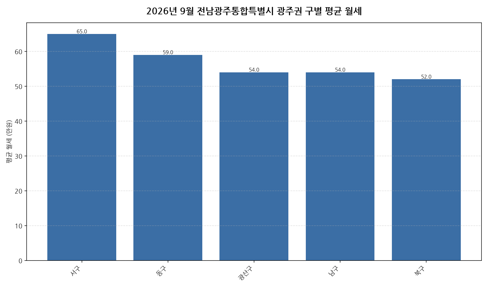

공공데이터포털의 국토교통부 아파트 전월세 실거래자료를 파이썬으로 직접 수집·분석해
2026년 9월 전남광주통합특별시 광주권 아파트 월세(반전세 포함) 시장 흐름을 정리했습니다.

## 분석 방법

- 데이터 출처: [국토교통부 아파트 전월세 실거래자료](https://www.data.go.kr/data/15126474/openapi.do) (공공데이터포털 Open API)
- 분석 대상: 전남광주통합특별시 광주권 5개 구, 2026년 9월 신고 기준 월세(반전세 포함) 계약
- 비교 기준월: 2026년 8월 (전월 대비 증감률 계산용)
- 실거래 신고는 계약 후 30일 이내에 이루어지므로, 최근월 데이터는 이후 계속 소폭 갱신될 수 있습니다.
- 데이터 수집 기준일: 2026-10-28. 이후 늦게 신고된 계약이 반영되면 같은 달을 다룬 다른 글과 수치가 조금 다를 수 있습니다.

## 전남광주통합특별시 광주권 구별 평균 월세와 전월 대비 변화

| 구 | 평균 월세(만원) | 중위 월세(만원) | 전월 대비 | 거래건수 |
|---|---:|---:|---:|---:|
| 서구 | 65.0 | 55.0 | +6.6% | 141 |
| 동구 | 59.0 | 54.0 | -9.2% | 58 |
| 광산구 | 54.0 | 50.0 | +5.9% | 294 |
| 남구 | 54.0 | 45.0 | +0.0% | 109 |
| 북구 | 52.0 | 45.0 | -8.8% | 256 |

## 전남광주통합특별시 광주권 9월 월세 시장 인사이트

- 2026년 9월 전남광주통합특별시 광주권 아파트 월세(반전세 포함) 평균 월세는 약 55.6만원으로, 전월 대비 0.5% 하락했습니다.
- 5개 구 중 평균 월세가 가장 높은 곳은 서구(약 65.0만원)이었고, 가장 낮은 곳은 북구(약 52.0만원)이었습니다.
- 거래량 기준으로는 광산구에서 294건으로 가장 활발하게 월세(반전세 포함) 계약이 체결됐습니다.
- 전월 대비 평균이 가장 많이 오른 곳은 서구(+6.6%), 가장 많이 내린 곳은 동구(-9.2%)였습니다 (두 달 모두 10건 이상 거래된 곳만 비교).
- 2026년 9월 전남광주통합특별시 광주권에서 신고된 월세(반전세 포함) 계약은 총 858건입니다 (순수 전세 계약은 제외).
