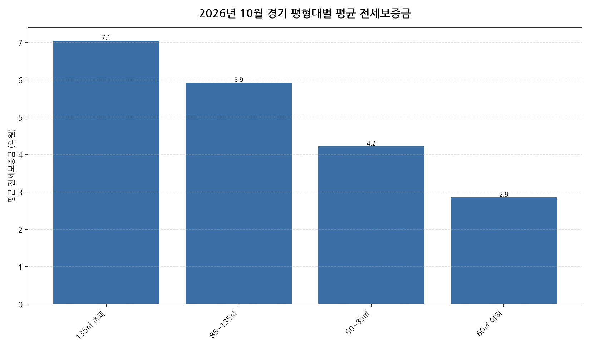

공공데이터포털의 국토교통부 아파트 전월세 실거래자료를 파이썬으로 직접 수집·분석해
2026년 10월 경기 아파트 순수 전세 시장 흐름을 정리했습니다.

## 분석 방법

- 데이터 출처: [국토교통부 아파트 전월세 실거래자료](https://www.data.go.kr/data/15126474/openapi.do) (공공데이터포털 Open API)
- 분석 대상: 경기 4개 평형대 구간, 2026년 10월 신고 기준 순수 전세 계약
- 비교 기준월: 2026년 9월 (전월 대비 증감률 계산용)
- 실거래 신고는 계약 후 30일 이내에 이루어지므로, 최근월 데이터는 이후 계속 소폭 갱신될 수 있습니다.
- 데이터 수집 기준일: 2026-11-13. 이후 늦게 신고된 계약이 반영되면 같은 달을 다룬 다른 글과 수치가 조금 다를 수 있습니다.

## 경기 평형대별 평균 전세보증금과 전월 대비 변화

| 평형대 | 평균 전세보증금(억원) | 중위 전세보증금(억원) | 전월 대비 | 거래건수 |
|---|---:|---:|---:|---:|
| 135㎡ 초과 | 7.1 | 6.5 | -3.6% | 213 |
| 85~135㎡ | 5.9 | 5.4 | +2.3% | 1,323 |
| 60~85㎡ | 4.2 | 3.9 | +6.6% | 5,421 |
| 60㎡ 이하 | 2.9 | 2.6 | +4.3% | 4,679 |

## 경기 10월 평형대별 전세가 인사이트

- 2026년 10월 경기 아파트 순수 전세 평균 전세보증금은 약 3.9억원으로, 전월 대비 6.6% 상승했습니다.
- 4개 평형대 구간 중 평균 전세보증금이 가장 높은 구간은 135㎡ 초과(약 7.1억원)이었고, 가장 낮은 구간은 60㎡ 이하(약 2.9억원)이었습니다.
- 거래량 기준으로는 60~85㎡에서 5421건으로 가장 활발하게 순수 전세 계약이 체결됐습니다.
- 전월 대비 평균이 가장 많이 오른 구간은 60~85㎡(+6.6%), 가장 많이 내린 구간은 135㎡ 초과(-3.6%)였습니다 (두 달 모두 10건 이상 거래된 구간만 비교).
- 2026년 10월 경기에서 신고된 순수 전세 계약은 총 11636건입니다 (월세를 낀 반전세/월세 계약은 제외).

---

이런 데이터를 직접 파이썬으로 분석해보고 싶으신 분들을 위해, 공공데이터포털 아파트 매매/전월세 데이터를 분석하는 방법을 담은 전자책 《파이썬을 활용한 부동산 시장 분석_아파트편》을 준비했어요. 2026년 데이터를 기준으로 다루고 있고, 교보문고에서 만나보실 수 있어요: https://ebook-product.kyobobook.co.kr/dig/epd/ebook/480D250151380
