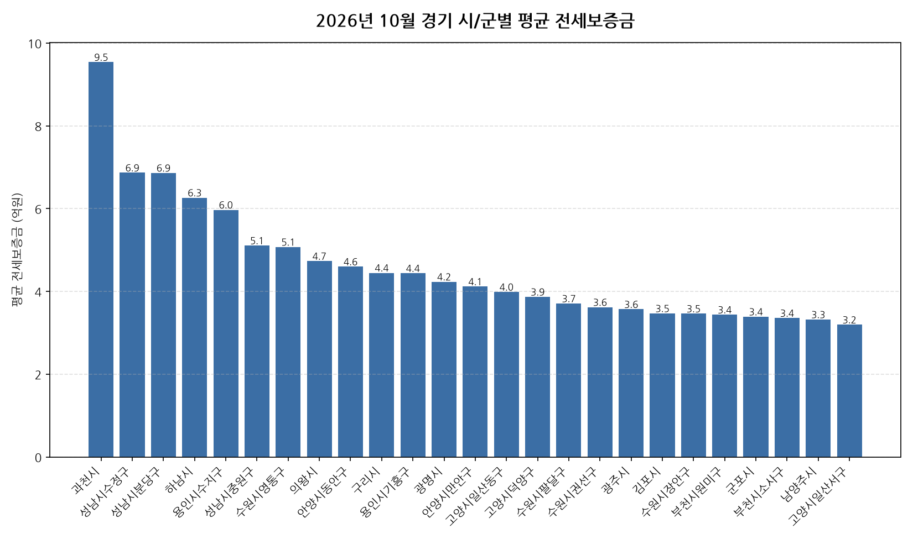

공공데이터포털의 국토교통부 아파트 전월세 실거래자료를 파이썬으로 직접 수집·분석해
2026년 10월 경기 아파트 순수 전세 시장 흐름을 정리했습니다.

## 분석 방법

- 데이터 출처: [국토교통부 아파트 전월세 실거래자료](https://www.data.go.kr/data/15126474/openapi.do) (공공데이터포털 Open API)
- 분석 대상: 경기 43개 시/군, 2026년 10월 신고 기준 순수 전세 계약
- 비교 기준월: 2026년 9월 (전월 대비 증감률 계산용)
- 실거래 신고는 계약 후 30일 이내에 이루어지므로, 최근월 데이터는 이후 계속 소폭 갱신될 수 있습니다.
- 데이터 수집 기준일: 2026-11-09. 이후 늦게 신고된 계약이 반영되면 같은 달을 다룬 다른 글과 수치가 조금 다를 수 있습니다.

## 경기 시/군별 평균 전세보증금과 전월 대비 변화

| 시/군 | 평균 전세보증금(억원) | 중위 전세보증금(억원) | 전월 대비 | 거래건수 |
|---|---:|---:|---:|---:|
| 과천시 | 9.5 | 9.3 | -0.0% | 71 |
| 성남시수정구 | 6.9 | 7.0 | +1.3% | 150 |
| 성남시분당구 | 6.9 | 6.8 | +0.3% | 563 |
| 하남시 | 6.3 | 6.4 | +2.8% | 357 |
| 용인시수지구 | 6.0 | 5.9 | +3.1% | 429 |
| 성남시중원구 | 5.1 | 5.3 | +1.6% | 173 |
| 수원시영통구 | 5.1 | 4.4 | +15.1% | 419 |
| 의왕시 | 4.7 | 4.7 | +3.0% | 136 |
| 안양시동안구 | 4.6 | 4.5 | +8.6% | 469 |
| 구리시 | 4.4 | 4.5 | +1.7% | 197 |
| 용인시기흥구 | 4.4 | 4.4 | +5.2% | 415 |
| 광명시 | 4.2 | 3.9 | -2.2% | 338 |
| 안양시만안구 | 4.1 | 4.2 | +0.8% | 210 |
| 고양시일산동구 | 4.0 | 3.6 | -2.4% | 250 |
| 고양시덕양구 | 3.9 | 4.0 | +6.9% | 579 |
| 수원시팔달구 | 3.7 | 3.8 | +4.9% | 204 |
| 수원시권선구 | 3.6 | 3.6 | +4.0% | 310 |
| 광주시 | 3.6 | 3.5 | +4.7% | 189 |
| 김포시 | 3.5 | 3.4 | +3.4% | 432 |
| 수원시장안구 | 3.5 | 3.4 | -3.6% | 147 |
| 부천시원미구 | 3.4 | 3.0 | -2.1% | 288 |
| 군포시 | 3.4 | 3.0 | +7.9% | 256 |
| 부천시소사구 | 3.4 | 3.5 | +1.3% | 92 |
| 남양주시 | 3.3 | 3.0 | +11.1% | 973 |
| 고양시일산서구 | 3.2 | 2.9 | +2.2% | 351 |
| 파주시 | 3.0 | 3.1 | +2.0% | 396 |
| 시흥시 | 2.8 | 2.9 | +2.5% | 401 |
| 용인시처인구 | 2.8 | 2.8 | +3.7% | 165 |
| 안산시단원구 | 2.8 | 3.0 | +0.1% | 236 |
| 양평군 | 2.7 | 2.7 | -0.2% | 23 |
| 의정부시 | 2.7 | 2.6 | +2.4% | 332 |
| 안산시상록구 | 2.7 | 2.5 | +6.0% | 151 |
| 오산시 | 2.7 | 2.7 | -0.9% | 202 |
| 부천시오정구 | 2.4 | 1.9 | -4.9% | 39 |
| 양주시 | 2.4 | 2.4 | +0.8% | 223 |
| 평택시 | 2.2 | 2.3 | -0.5% | 580 |
| 이천시 | 2.2 | 2.0 | +3.9% | 201 |
| 안성시 | 1.8 | 1.9 | +2.9% | 112 |
| 포천시 | 1.7 | 1.9 | -2.1% | 26 |
| 여주시 | 1.6 | 1.3 | -25.8% | 32 |
| 가평군 | 1.6 | 1.6 | - | 4 |
| 연천군 | 1.5 | 1.3 | - | 7 |
| 동두천시 | 1.3 | 1.3 | -0.3% | 31 |

## 경기 10월 전세가 동향 인사이트

- 2026년 10월 경기 아파트 순수 전세 평균 전세보증금은 약 3.9억원으로, 전월 대비 6.4% 상승했습니다.
- 43개 시/군 중 평균 전세보증금이 가장 높은 곳은 과천시(약 9.5억원)이었고, 가장 낮은 곳은 동두천시(약 1.3억원)이었습니다.
- 거래량 기준으로는 남양주시에서 973건으로 가장 활발하게 순수 전세 계약이 체결됐습니다.
- 전월 대비 평균이 가장 많이 오른 곳은 수원시영통구(+15.1%), 가장 많이 내린 곳은 여주시(-25.8%)였습니다 (두 달 모두 10건 이상 거래된 곳만 비교).
- 2026년 10월 경기에서 신고된 순수 전세 계약은 총 11159건입니다 (월세를 낀 반전세/월세 계약은 제외).
