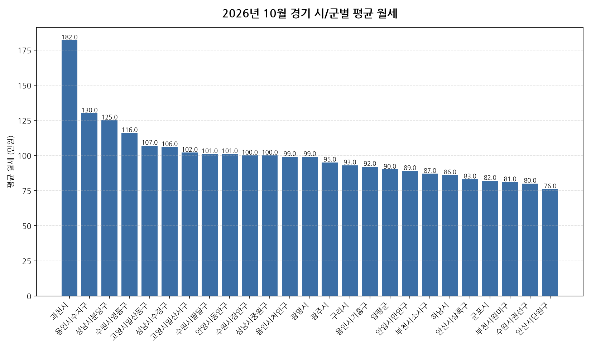

공공데이터포털의 국토교통부 아파트 전월세 실거래자료를 파이썬으로 직접 수집·분석해
2026년 10월 경기 아파트 월세(반전세 포함) 시장 흐름을 정리했습니다.

## 분석 방법

- 데이터 출처: [국토교통부 아파트 전월세 실거래자료](https://www.data.go.kr/data/15126474/openapi.do) (공공데이터포털 Open API)
- 분석 대상: 경기 43개 시/군, 2026년 10월 신고 기준 월세(반전세 포함) 계약
- 비교 기준월: 2026년 9월 (전월 대비 증감률 계산용)
- 실거래 신고는 계약 후 30일 이내에 이루어지므로, 최근월 데이터는 이후 계속 소폭 갱신될 수 있습니다.
- 데이터 수집 기준일: 2026-11-11. 이후 늦게 신고된 계약이 반영되면 같은 달을 다룬 다른 글과 수치가 조금 다를 수 있습니다.

## 경기 시/군별 평균 월세와 전월 대비 변화

| 시/군 | 평균 월세(만원) | 중위 월세(만원) | 전월 대비 | 거래건수 |
|---|---:|---:|---:|---:|
| 과천시 | 182.0 | 154.0 | +65.5% | 66 |
| 용인시수지구 | 130.0 | 140.0 | -1.5% | 294 |
| 성남시분당구 | 125.0 | 100.0 | +0.8% | 506 |
| 수원시영통구 | 116.0 | 100.0 | +22.1% | 294 |
| 고양시일산동구 | 107.0 | 100.0 | +21.6% | 122 |
| 성남시수정구 | 106.0 | 76.0 | +26.2% | 156 |
| 고양시일산서구 | 102.0 | 95.0 | +6.2% | 166 |
| 수원시팔달구 | 101.0 | 87.0 | +11.0% | 135 |
| 안양시동안구 | 101.0 | 95.0 | +11.0% | 293 |
| 수원시장안구 | 100.0 | 100.0 | +5.3% | 96 |
| 성남시중원구 | 100.0 | 90.0 | +20.5% | 137 |
| 용인시처인구 | 99.0 | 100.0 | -10.0% | 192 |
| 광명시 | 99.0 | 85.0 | -3.9% | 215 |
| 광주시 | 95.0 | 100.0 | -4.0% | 146 |
| 구리시 | 93.0 | 90.0 | +63.2% | 115 |
| 용인시기흥구 | 92.0 | 80.0 | -13.2% | 276 |
| 양평군 | 90.0 | 90.0 | -13.5% | 20 |
| 안양시만안구 | 89.0 | 80.0 | +34.8% | 81 |
| 부천시소사구 | 87.0 | 78.0 | +26.1% | 76 |
| 하남시 | 86.0 | 54.0 | +8.9% | 359 |
| 안산시상록구 | 83.0 | 75.0 | +3.8% | 91 |
| 군포시 | 82.0 | 80.0 | +13.9% | 127 |
| 부천시원미구 | 81.0 | 70.0 | +5.2% | 178 |
| 수원시권선구 | 80.0 | 68.0 | +6.7% | 212 |
| 안산시단원구 | 76.0 | 70.0 | -7.3% | 179 |
| 시흥시 | 71.0 | 60.0 | +39.2% | 387 |
| 김포시 | 70.0 | 50.0 | +40.0% | 560 |
| 이천시 | 68.0 | 65.0 | -18.1% | 160 |
| 여주시 | 65.0 | 55.0 | +16.1% | 53 |
| 남양주시 | 60.0 | 32.0 | +30.4% | 718 |
| 고양시덕양구 | 59.0 | 35.0 | +22.9% | 428 |
| 오산시 | 56.0 | 28.0 | +0.0% | 340 |
| 양주시 | 56.0 | 42.0 | -3.4% | 443 |
| 평택시 | 55.0 | 40.0 | -15.4% | 1,312 |
| 포천시 | 53.0 | 50.0 | -3.6% | 43 |
| 의정부시 | 52.0 | 40.0 | -3.7% | 408 |
| 부천시오정구 | 51.0 | 48.0 | -19.0% | 64 |
| 안성시 | 51.0 | 55.0 | +37.8% | 355 |
| 가평군 | 49.0 | 42.0 | - | 14 |
| 파주시 | 45.0 | 31.0 | -19.6% | 1,226 |
| 동두천시 | 42.0 | 42.0 | -4.5% | 48 |
| 연천군 | 41.0 | 40.0 | -37.9% | 16 |
| 의왕시 | 41.0 | 14.0 | -19.6% | 263 |

## 경기 10월 월세 시장 인사이트

- 2026년 10월 경기 아파트 월세(반전세 포함) 평균 월세는 약 73.8만원으로, 전월 대비 7.2% 상승했습니다.
- 43개 시/군 중 평균 월세가 가장 높은 곳은 과천시(약 182.0만원)이었고, 가장 낮은 곳은 의왕시(약 41.0만원)이었습니다.
- 거래량 기준으로는 평택시에서 1312건으로 가장 활발하게 월세(반전세 포함) 계약이 체결됐습니다.
- 전월 대비 평균이 가장 많이 오른 곳은 과천시(+65.5%), 가장 많이 내린 곳은 연천군(-37.9%)였습니다 (두 달 모두 10건 이상 거래된 곳만 비교).
- 2026년 10월 경기에서 신고된 월세(반전세 포함) 계약은 총 11370건입니다 (순수 전세 계약은 제외).
