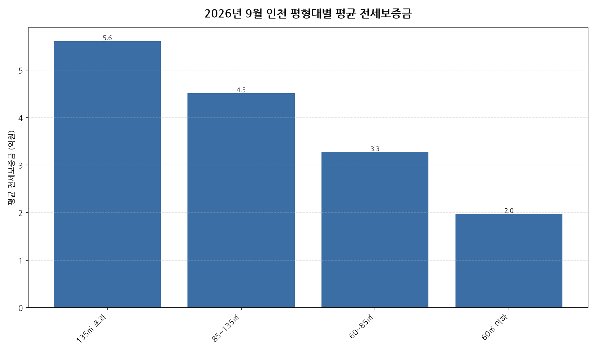

> **정정 안내 (2026-10-27)**: 처음 발행한 글은 2026년 7월 1일 인천 행정구역 개편(중구·동구·서구 폐지, 제물포구·영종구·서해구·검단구 신설)으로 바뀐 지역 코드를 반영하지 못해, 해당 지역의 거래가 빠진 채 집계됐습니다. 개편 후 바뀐 구/군 코드로 데이터를 다시 수집해 표·차트·수치를 모두 바로잡았습니다.

공공데이터포털의 국토교통부 아파트 전월세 실거래자료를 파이썬으로 직접 수집·분석해
2026년 9월 인천 아파트 순수 전세 시장 흐름을 정리했습니다.

## 분석 방법

- 데이터 출처: [국토교통부 아파트 전월세 실거래자료](https://www.data.go.kr/data/15126474/openapi.do) (공공데이터포털 Open API)
- 분석 대상: 인천 4개 평형대 구간, 2026년 9월 신고 기준 순수 전세 계약
- 비교 기준월: 2026년 8월 (전월 대비 증감률 계산용)
- 실거래 신고는 계약 후 30일 이내에 이루어지므로, 최근월 데이터는 이후 계속 소폭 갱신될 수 있습니다.
- 데이터 수집 기준일: 2026-10-27. 이후 늦게 신고된 계약이 반영되면 같은 달을 다룬 다른 글과 수치가 조금 다를 수 있습니다.

## 인천 평형대별 평균 전세보증금과 전월 대비 변화

| 평형대 | 평균 전세보증금(억원) | 중위 전세보증금(억원) | 전월 대비 | 거래건수 |
|---|---:|---:|---:|---:|
| 135㎡ 초과 | 5.6 | 5.0 | +5.1% | 33 |
| 85~135㎡ | 4.5 | 4.3 | +2.5% | 267 |
| 60~85㎡ | 3.3 | 3.3 | -0.8% | 948 |
| 60㎡ 이하 | 2.0 | 1.8 | -0.3% | 728 |

## 인천 9월 평형대별 전세가 인사이트

- 2026년 9월 인천 아파트 순수 전세 평균 전세보증금은 약 3.0억원으로, 전월 대비 0.7% 하락했습니다.
- 4개 평형대 구간 중 평균 전세보증금이 가장 높은 구간은 135㎡ 초과(약 5.6억원)이었고, 가장 낮은 구간은 60㎡ 이하(약 2.0억원)이었습니다.
- 거래량 기준으로는 60~85㎡에서 948건으로 가장 활발하게 순수 전세 계약이 체결됐습니다.
- 전월 대비 평균이 가장 많이 오른 구간은 135㎡ 초과(+5.1%), 가장 많이 내린 구간은 60~85㎡(-0.8%)이었습니다 (두 달 모두 10건 이상 거래된 구간만 비교).
- 2026년 9월 인천에서 신고된 순수 전세 계약은 총 1976건입니다 (월세를 낀 반전세/월세 계약은 제외).
