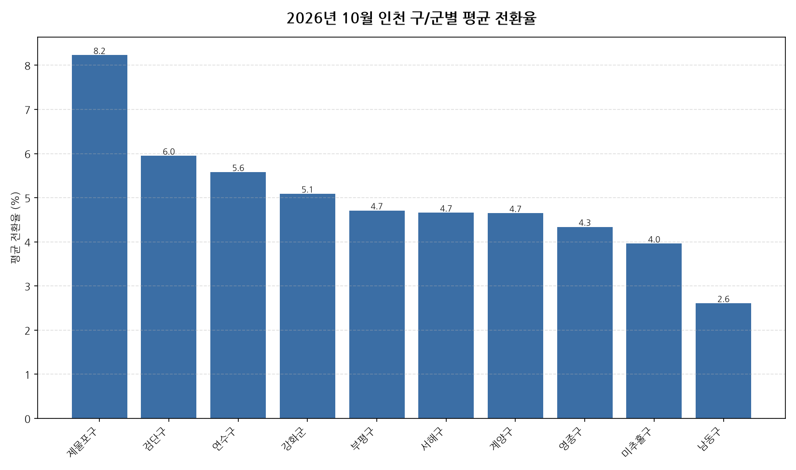

공공데이터포털의 국토교통부 아파트 전월세 실거래자료를 파이썬으로 직접 수집·분석해
2026년 10월 인천 아파트 반전세(전월세 전환) 시장 흐름을 정리했습니다.

## 분석 방법

- 데이터 출처: [국토교통부 아파트 전월세 실거래자료](https://www.data.go.kr/data/15126474/openapi.do) (공공데이터포털 Open API)
- 분석 대상: 인천 10개 구/군, 2026년 10월 신고 기준 반전세(전월세 전환) 계약
- 비교 기준월: 2026년 9월 (전월 대비 증감률 계산용)
- 실거래 신고는 계약 후 30일 이내에 이루어지므로, 최근월 데이터는 이후 계속 소폭 갱신될 수 있습니다.
- 데이터 수집 기준일: 2026-11-16. 이후 늦게 신고된 계약이 반영되면 같은 달을 다룬 다른 글과 수치가 조금 다를 수 있습니다.
- 전월세 전환율은 실제 시세 대신 같은 자치구·같은 달의 순수 전세 평균 보증금을 기준가로 삼아 추정한 값입니다(연 환산 %).

## 인천 구/군별 평균 전환율과 전월 대비 변화

| 구/군 | 평균 전환율(%) | 중위 전환율(%) | 전월 대비 | 거래건수 |
|---|---:|---:|---:|---:|
| 제물포구 | 8.2 | 6.7 | -0.51%p | 63 |
| 검단구 | 6.0 | 6.5 | +0.51%p | 224 |
| 연수구 | 5.6 | 5.6 | -0.11%p | 371 |
| 강화군 | 5.1 | 5.0 | +0.55%p | 20 |
| 부평구 | 4.7 | 4.1 | +0.91%p | 253 |
| 서해구 | 4.7 | 4.5 | +0.37%p | 134 |
| 계양구 | 4.7 | 3.5 | -0.06%p | 117 |
| 영종구 | 4.3 | 4.6 | -0.64%p | 168 |
| 미추홀구 | 4.0 | 3.2 | +0.18%p | 186 |
| 남동구 | 2.6 | 1.6 | -0.55%p | 359 |

## 인천 10월 전월세 전환율 인사이트

- 2026년 10월 인천 아파트 반전세(전월세 전환) 평균 전환율은 약 4.6%로, 전월 대비 0.04%p 상승했습니다.
- 10개 구/군 중 평균 전환율이 가장 높은 곳은 제물포구(약 8.2%)였고, 가장 낮은 곳은 남동구(약 2.6%)였습니다.
- 거래량 기준으로는 연수구에서 371건으로 가장 활발하게 반전세(전월세 전환) 계약이 체결됐습니다.
- 전월 대비 평균이 가장 많이 오른 곳은 부평구(+0.91%p), 가장 많이 내린 곳은 영종구(-0.64%p)였습니다 (두 달 모두 10건 이상 거래된 곳만 비교).
- 2026년 10월 인천에서 신고된 반전세(전월세 전환) 계약은 총 1895건입니다 (같은 자치구·같은 달 순수 전세 평균가 대비 환산한 추정치이며, 전환율이 0% 이하이거나 30%를 넘는 이상치는 제외).
