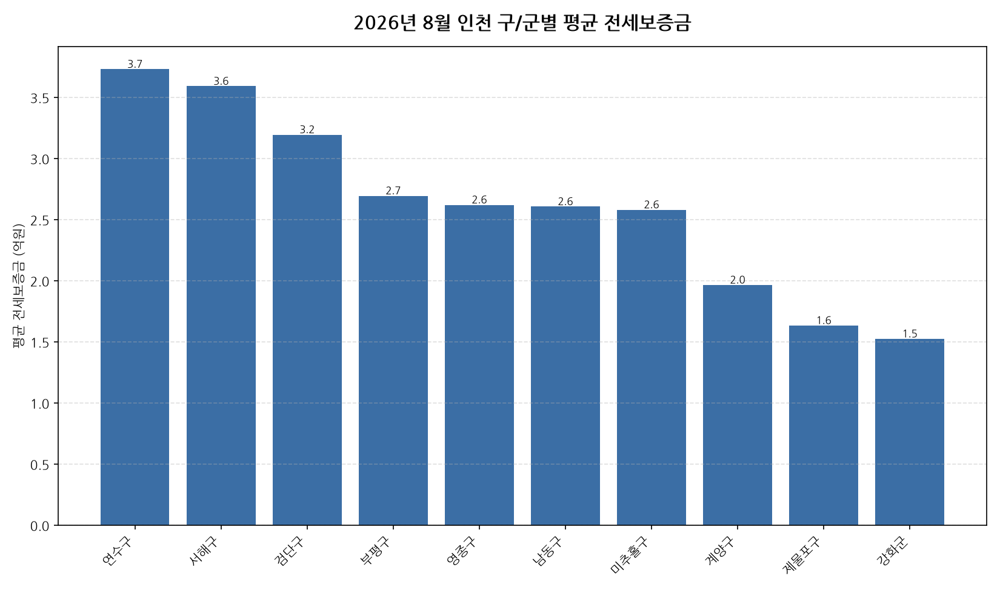

> **정정 안내 (2026-10-27)**: 처음 발행한 글은 2026년 7월 1일 인천 행정구역 개편(중구·동구·서구 폐지, 제물포구·영종구·서해구·검단구 신설)으로 바뀐 지역 코드를 반영하지 못해, 해당 지역의 거래가 빠진 채 집계됐습니다. 개편 후 11개 구/군 기준으로 데이터를 다시 수집해 표·차트·수치를 모두 바로잡았습니다.

공공데이터포털의 국토교통부 아파트 전월세 실거래자료를 파이썬으로 직접 수집·분석해
2026년 8월 인천 아파트 순수 전세 시장 흐름을 정리했습니다.

## 분석 방법

- 데이터 출처: [국토교통부 아파트 전월세 실거래자료](https://www.data.go.kr/data/15126474/openapi.do) (공공데이터포털 Open API)
- 분석 대상: 인천 10개 구/군, 2026년 8월 신고 기준 순수 전세 계약
- 비교 기준월: 2026년 7월 (전월 대비 증감률 계산용)
- 실거래 신고는 계약 후 30일 이내에 이루어지므로, 최근월 데이터는 이후 계속 소폭 갱신될 수 있습니다.
- 데이터 수집 기준일: 2026-10-27. 이후 늦게 신고된 계약이 반영되면 같은 달을 다룬 다른 글과 수치가 조금 다를 수 있습니다.

## 인천 구/군별 평균 전세보증금과 전월 대비 변화

| 구/군 | 평균 전세보증금(억원) | 중위 전세보증금(억원) | 전월 대비 | 거래건수 |
|---|---:|---:|---:|---:|
| 연수구 | 3.7 | 3.8 | +0.6% | 553 |
| 서해구 | 3.6 | 3.7 | +15.8% | 234 |
| 검단구 | 3.2 | 3.3 | +0.5% | 338 |
| 부평구 | 2.7 | 2.5 | +2.4% | 286 |
| 영종구 | 2.6 | 2.7 | +2.2% | 188 |
| 남동구 | 2.6 | 2.7 | +7.5% | 246 |
| 미추홀구 | 2.6 | 2.8 | -0.7% | 136 |
| 계양구 | 2.0 | 1.7 | -2.8% | 185 |
| 제물포구 | 1.6 | 1.6 | -5.8% | 33 |
| 강화군 | 1.5 | 1.5 | - | 2 |

## 인천 8월 전세가 동향 인사이트

- 2026년 8월 인천 아파트 순수 전세 평균 전세보증금은 약 3.0억원으로, 전월 대비 3.8% 상승했습니다.
- 10개 구/군 중 평균 전세보증금이 가장 높은 곳은 연수구(약 3.7억원)이었고, 가장 낮은 곳은 강화군(약 1.5억원)이었습니다.
- 거래량 기준으로는 연수구에서 553건으로 가장 활발하게 순수 전세 계약이 체결됐습니다.
- 전월 대비 평균이 가장 많이 오른 곳은 서해구(+15.8%), 가장 많이 내린 곳은 제물포구(-5.8%)이었습니다 (두 달 모두 10건 이상 거래된 곳만 비교).
- 2026년 8월 인천에서 신고된 순수 전세 계약은 총 2201건입니다 (월세를 낀 반전세/월세 계약은 제외).
