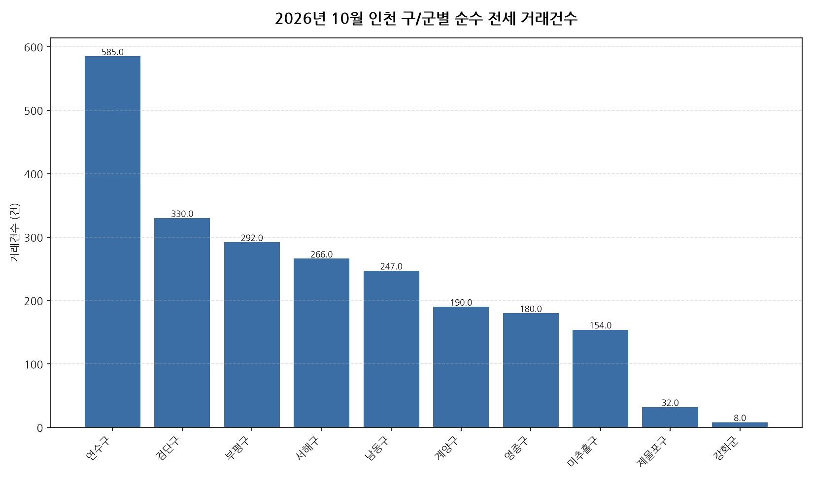

공공데이터포털의 국토교통부 아파트 전월세 실거래자료를 파이썬으로 직접 수집·분석해
2026년 10월 인천 아파트 순수 전세 거래량과 가격 변동률 사이의 관계를 살펴봤습니다.

## 분석 방법

- 데이터 출처: [국토교통부 아파트 전월세 실거래자료](https://www.data.go.kr/data/15126474/openapi.do) (공공데이터포털 Open API)
- 분석 대상: 인천 10개 구/군, 2026년 10월 신고 기준 순수 전세 계약
- 비교 기준월: 2026년 9월 (전월 대비 가격 변동률 계산용)
- 가격 변동률은 구/군별 평균 전세보증금 기준이며, 거래건수는 순수 전세 계약 건수 기준입니다.
- 데이터 수집 기준일: 2026-11-18. 이후 늦게 신고된 계약이 반영되면 같은 달을 다룬 다른 글과 수치가 조금 다를 수 있습니다.

## 인천 구/군별 거래건수와 가격 변동률

| 구/군 | 거래건수 | 가격변동률(전월 대비) |
|---|---:|---:|
| 연수구 | 585 | +3.0% |
| 검단구 | 330 | +2.6% |
| 부평구 | 292 | -0.0% |
| 서해구 | 266 | +1.9% |
| 남동구 | 247 | +7.3% |
| 계양구 | 190 | +1.4% |
| 영종구 | 180 | +5.2% |
| 미추홀구 | 154 | +2.0% |
| 제물포구 | 32 | -17.4% |
| 강화군 | 8 | -4.8% |

## 인천 10월 전세 거래량-가격 인사이트

- 2026년 10월 인천 10개 구/군 중 순수 전세 거래가 가장 활발한 곳은 연수구(585건)이었습니다.
- 전월 대비 평균 전세보증금이 가장 많이 오른 곳은 남동구(+7.3%), 가장 많이 내린 곳은 제물포구(-17.4%)였습니다.
- 거래건수와 가격 변동률의 상관계수는 0.55로, 뚜렷한 비례(거래가 많을수록 가격도 더 올랐음) 관계를 보였습니다.
- 상관관계는 인과관계를 의미하지 않으며, 표본 수가 적은 구/군은 결과가 왜곡될 수 있습니다.
