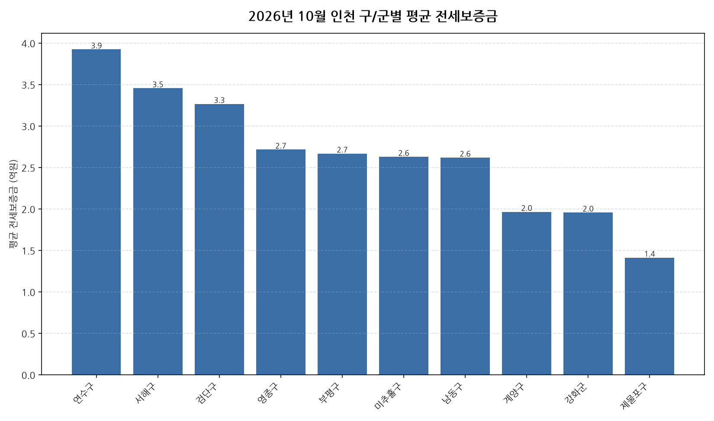

공공데이터포털의 국토교통부 아파트 전월세 실거래자료를 파이썬으로 직접 수집·분석해
2026년 10월 인천 아파트 순수 전세 시장 흐름을 정리했습니다.

## 분석 방법

- 데이터 출처: [국토교통부 아파트 전월세 실거래자료](https://www.data.go.kr/data/15126474/openapi.do) (공공데이터포털 Open API)
- 분석 대상: 인천 10개 구/군, 2026년 10월 신고 기준 순수 전세 계약
- 비교 기준월: 2025년 10월 (전년 동월 대비 증감률 계산용)
- 실거래 신고는 계약 후 30일 이내에 이루어지므로, 최근월 데이터는 이후 계속 소폭 갱신될 수 있습니다.
- 데이터 수집 기준일: 2026-11-20. 이후 늦게 신고된 계약이 반영되면 같은 달을 다룬 다른 글과 수치가 조금 다를 수 있습니다.
- 2025년 10월 데이터는 행정구역 개편(2026-07-01) 이전이지만, 국토교통부 API가 현재 구/군 기준으로 재분류해 제공하는 값을 사용했습니다.

## 인천 구/군별 평균 전세보증금과 전년 동월 대비 변화

| 구/군 | 평균 전세보증금(억원) | 중위 전세보증금(억원) | 전년 동월 대비 | 거래건수 |
|---|---:|---:|---:|---:|
| 연수구 | 3.9 | 3.8 | +9.4% | 592 |
| 서해구 | 3.5 | 3.5 | +10.3% | 270 |
| 검단구 | 3.3 | 3.5 | +7.6% | 331 |
| 영종구 | 2.7 | 2.8 | +13.0% | 182 |
| 부평구 | 2.7 | 2.5 | +4.1% | 296 |
| 미추홀구 | 2.6 | 2.8 | +13.4% | 156 |
| 남동구 | 2.6 | 2.8 | +1.9% | 248 |
| 계양구 | 2.0 | 1.7 | -5.2% | 192 |
| 강화군 | 2.0 | 1.9 | - | 9 |
| 제물포구 | 1.4 | 1.3 | -21.0% | 32 |

## 인천 10월 전세가 1년 전 대비 인사이트

- 2026년 10월 인천 아파트 순수 전세 평균 전세보증금은 약 3.1억원으로, 전년 동월 대비 8.1% 상승했습니다.
- 10개 구/군 중 평균 전세보증금이 가장 높은 곳은 연수구(약 3.9억원)이었고, 가장 낮은 곳은 제물포구(약 1.4억원)이었습니다.
- 거래량 기준으로는 연수구에서 592건으로 가장 활발하게 순수 전세 계약이 체결됐습니다.
- 전년 동월 대비 평균이 가장 많이 오른 곳은 미추홀구(+13.4%), 가장 많이 내린 곳은 제물포구(-21.0%)였습니다 (두 달 모두 10건 이상 거래된 곳만 비교).
- 2026년 10월 인천에서 신고된 순수 전세 계약은 총 2308건입니다 (월세를 낀 반전세/월세 계약은 제외).
