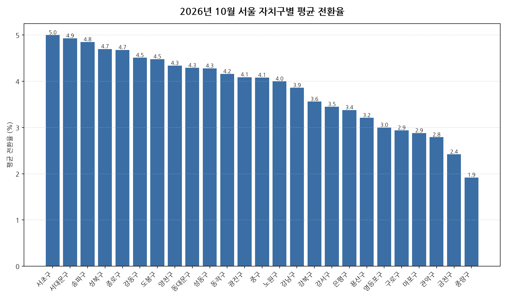

공공데이터포털의 국토교통부 아파트 전월세 실거래자료를 파이썬으로 직접 수집·분석해
2026년 10월 서울 아파트 반전세(전월세 전환) 시장 흐름을 정리했습니다.

## 분석 방법

- 데이터 출처: [국토교통부 아파트 전월세 실거래자료](https://www.data.go.kr/data/15126474/openapi.do) (공공데이터포털 Open API)
- 분석 대상: 서울 25개 자치구, 2026년 10월 신고 기준 반전세(전월세 전환) 계약
- 비교 기준월: 2026년 9월 (전월 대비 증감률 계산용)
- 실거래 신고는 계약 후 30일 이내에 이루어지므로, 최근월 데이터는 이후 계속 소폭 갱신될 수 있습니다.
- 데이터 수집 기준일: 2026-11-02. 이후 늦게 신고된 계약이 반영되면 같은 달을 다룬 다른 글과 수치가 조금 다를 수 있습니다.
- 전월세 전환율은 실제 시세 대신 같은 자치구·같은 달의 순수 전세 평균 보증금을 기준가로 삼아 추정한 값입니다(연 환산 %).

## 서울 자치구별 평균 전환율과 전월 대비 변화

| 자치구 | 평균 전환율(%) | 중위 전환율(%) | 전월 대비 | 거래건수 |
|---|---:|---:|---:|---:|
| 서초구 | 5.0 | 3.5 | +1.02%p | 237 |
| 서대문구 | 4.9 | 3.8 | +0.69%p | 152 |
| 송파구 | 4.8 | 3.5 | +0.14%p | 454 |
| 성북구 | 4.7 | 4.4 | +0.63%p | 154 |
| 종로구 | 4.7 | 2.4 | +1.87%p | 51 |
| 강동구 | 4.5 | 3.4 | +0.33%p | 349 |
| 도봉구 | 4.5 | 3.1 | +0.14%p | 131 |
| 양천구 | 4.3 | 3.2 | +0.48%p | 211 |
| 동대문구 | 4.3 | 2.9 | +0.69%p | 195 |
| 성동구 | 4.3 | 3.8 | -0.75%p | 219 |
| 동작구 | 4.2 | 3.1 | +1.09%p | 187 |
| 광진구 | 4.1 | 3.3 | +0.72%p | 124 |
| 중구 | 4.1 | 3.7 | -0.56%p | 91 |
| 노원구 | 4.0 | 3.1 | +0.25%p | 444 |
| 강남구 | 3.9 | 2.2 | +0.43%p | 473 |
| 강북구 | 3.6 | 2.8 | -0.30%p | 51 |
| 강서구 | 3.5 | 1.6 | -0.15%p | 270 |
| 은평구 | 3.4 | 2.0 | +0.64%p | 167 |
| 용산구 | 3.2 | 2.0 | -0.83%p | 158 |
| 영등포구 | 3.0 | 1.7 | +0.85%p | 277 |
| 구로구 | 2.9 | 1.9 | +0.02%p | 316 |
| 마포구 | 2.9 | 1.6 | -1.38%p | 447 |
| 관악구 | 2.8 | 1.5 | -0.94%p | 208 |
| 금천구 | 2.4 | 1.6 | -0.11%p | 105 |
| 중랑구 | 1.9 | 1.4 | +0.27%p | 460 |

## 서울 10월 전월세 전환율 인사이트

- 2026년 10월 서울 아파트 반전세(전월세 전환) 평균 전환율은 약 3.7%로, 전월 대비 0.31%p 상승했습니다.
- 25개 자치구 중 평균 전환율이 가장 높은 곳은 서초구(약 5.0%)였고, 가장 낮은 곳은 중랑구(약 1.9%)였습니다.
- 거래량 기준으로는 강남구에서 473건으로 가장 활발하게 반전세(전월세 전환) 계약이 체결됐습니다.
- 전월 대비 평균이 가장 많이 오른 곳은 종로구(+1.87%p), 가장 많이 내린 곳은 마포구(-1.38%p)였습니다 (두 달 모두 10건 이상 거래된 곳만 비교).
- 2026년 10월 서울에서 신고된 반전세(전월세 전환) 계약은 총 5931건입니다 (같은 자치구·같은 달 순수 전세 평균가 대비 환산한 추정치이며, 전환율이 0% 이하이거나 30%를 넘는 이상치는 제외).
