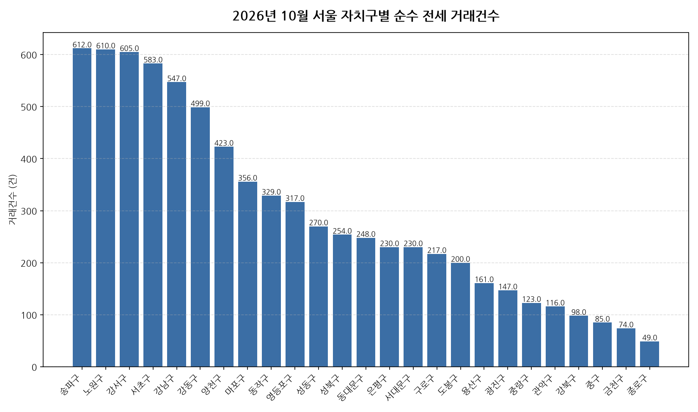

공공데이터포털의 국토교통부 아파트 전월세 실거래자료를 파이썬으로 직접 수집·분석해
2026년 10월 서울 아파트 순수 전세 거래량과 가격 변동률 사이의 관계를 살펴봤습니다.

## 분석 방법

- 데이터 출처: [국토교통부 아파트 전월세 실거래자료](https://www.data.go.kr/data/15126474/openapi.do) (공공데이터포털 Open API)
- 분석 대상: 서울 25개 자치구, 2026년 10월 신고 기준 순수 전세 계약
- 비교 기준월: 2026년 9월 (전월 대비 가격 변동률 계산용)
- 가격 변동률은 자치구별 평균 전세보증금 기준이며, 거래건수는 순수 전세 계약 건수 기준입니다.
- 데이터 수집 기준일: 2026-11-04. 이후 늦게 신고된 계약이 반영되면 같은 달을 다룬 다른 글과 수치가 조금 다를 수 있습니다.

## 서울 자치구별 거래건수와 가격 변동률

| 자치구 | 거래건수 | 가격변동률(전월 대비) |
|---|---:|---:|
| 송파구 | 612 | +2.7% |
| 노원구 | 610 | -0.7% |
| 강서구 | 605 | -0.7% |
| 서초구 | 583 | -9.8% |
| 강남구 | 547 | +7.9% |
| 강동구 | 499 | +7.8% |
| 양천구 | 423 | +0.4% |
| 마포구 | 356 | +17.4% |
| 동작구 | 329 | -3.5% |
| 영등포구 | 317 | +19.3% |
| 성동구 | 270 | +2.0% |
| 성북구 | 254 | +8.2% |
| 동대문구 | 248 | -5.2% |
| 은평구 | 230 | +32.3% |
| 서대문구 | 230 | +0.3% |
| 구로구 | 217 | +7.4% |
| 도봉구 | 200 | -2.9% |
| 용산구 | 161 | -9.8% |
| 광진구 | 147 | +3.6% |
| 중랑구 | 123 | +3.5% |
| 관악구 | 116 | -0.8% |
| 강북구 | 98 | +6.0% |
| 중구 | 85 | +0.4% |
| 금천구 | 74 | +9.1% |
| 종로구 | 49 | +22.4% |

## 서울 10월 전세 거래량-가격 인사이트

- 2026년 10월 서울 25개 자치구 중 순수 전세 거래가 가장 활발한 곳은 송파구(612건)이었습니다.
- 전월 대비 평균 전세보증금이 가장 많이 오른 곳은 은평구(+32.3%), 가장 많이 내린 곳은 서초구(-9.8%)였습니다.
- 거래건수와 가격 변동률의 상관계수는 -0.19로, 거의 없는 반비례(거래가 많을수록 가격이 더 내렸음) 관계를 보였습니다.
- 상관관계는 인과관계를 의미하지 않으며, 표본 수가 적은 자치구는 결과가 왜곡될 수 있습니다.

---

이런 데이터를 직접 파이썬으로 분석해보고 싶으신 분들을 위해, 공공데이터포털 아파트 매매/전월세 데이터를 분석하는 방법을 담은 전자책 《파이썬을 활용한 부동산 시장 분석_아파트편》을 준비했어요. 2026년 데이터를 기준으로 다루고 있고, 교보문고에서 만나보실 수 있어요: https://ebook-product.kyobobook.co.kr/dig/epd/ebook/480D250151380
