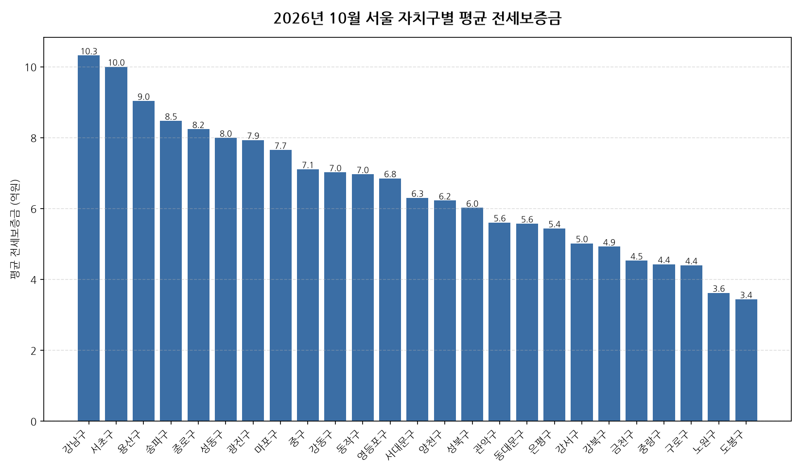

공공데이터포털의 국토교통부 아파트 전월세 실거래자료를 파이썬으로 직접 수집·분석해
2026년 10월 서울 아파트 순수 전세 시장 흐름을 정리했습니다.

## 분석 방법

- 데이터 출처: [국토교통부 아파트 전월세 실거래자료](https://www.data.go.kr/data/15126474/openapi.do) (공공데이터포털 Open API)
- 분석 대상: 서울 25개 자치구, 2026년 10월 신고 기준 순수 전세 계약
- 비교 기준월: 2025년 10월 (전년 동월 대비 증감률 계산용)
- 실거래 신고는 계약 후 30일 이내에 이루어지므로, 최근월 데이터는 이후 계속 소폭 갱신될 수 있습니다.
- 데이터 수집 기준일: 2026-11-06. 이후 늦게 신고된 계약이 반영되면 같은 달을 다룬 다른 글과 수치가 조금 다를 수 있습니다.

## 서울 자치구별 평균 전세보증금과 전년 동월 대비 변화

| 자치구 | 평균 전세보증금(억원) | 중위 전세보증금(억원) | 전년 동월 대비 | 거래건수 |
|---|---:|---:|---:|---:|
| 강남구 | 10.3 | 9.2 | +1.2% | 571 |
| 서초구 | 10.0 | 8.5 | -7.9% | 600 |
| 용산구 | 9.0 | 7.7 | +6.6% | 164 |
| 송파구 | 8.5 | 8.0 | +8.1% | 636 |
| 종로구 | 8.2 | 8.0 | +8.7% | 51 |
| 성동구 | 8.0 | 7.4 | +15.3% | 280 |
| 광진구 | 7.9 | 7.4 | +3.9% | 151 |
| 마포구 | 7.7 | 7.5 | +11.8% | 373 |
| 중구 | 7.1 | 7.2 | +5.9% | 93 |
| 강동구 | 7.0 | 6.6 | +13.8% | 512 |
| 동작구 | 7.0 | 6.9 | +2.2% | 341 |
| 영등포구 | 6.8 | 6.3 | +10.0% | 333 |
| 서대문구 | 6.3 | 6.4 | +10.6% | 237 |
| 양천구 | 6.2 | 5.9 | +15.2% | 434 |
| 성북구 | 6.0 | 6.0 | +18.2% | 262 |
| 관악구 | 5.6 | 5.6 | +12.2% | 123 |
| 동대문구 | 5.6 | 5.4 | +2.8% | 257 |
| 은평구 | 5.4 | 5.5 | +11.0% | 237 |
| 강서구 | 5.0 | 5.0 | +9.2% | 619 |
| 강북구 | 4.9 | 5.0 | +24.9% | 102 |
| 금천구 | 4.5 | 4.6 | +14.0% | 77 |
| 중랑구 | 4.4 | 4.2 | +4.3% | 126 |
| 구로구 | 4.4 | 4.3 | +20.3% | 224 |
| 노원구 | 3.6 | 3.1 | +9.1% | 644 |
| 도봉구 | 3.4 | 3.3 | +9.6% | 208 |

## 서울 10월 전세가 1년 전 대비 인사이트

- 2026년 10월 서울 아파트 순수 전세 평균 전세보증금은 약 6.8억원으로, 전년 동월 대비 6.9% 상승했습니다.
- 25개 자치구 중 평균 전세보증금이 가장 높은 곳은 강남구(약 10.3억원)이었고, 가장 낮은 곳은 도봉구(약 3.4억원)이었습니다.
- 거래량 기준으로는 노원구에서 644건으로 가장 활발하게 순수 전세 계약이 체결됐습니다.
- 전년 동월 대비 평균이 가장 많이 오른 곳은 강북구(+24.9%), 가장 많이 내린 곳은 서초구(-7.9%)였습니다 (두 달 모두 10건 이상 거래된 곳만 비교).
- 2026년 10월 서울에서 신고된 순수 전세 계약은 총 7655건입니다 (월세를 낀 반전세/월세 계약은 제외).
